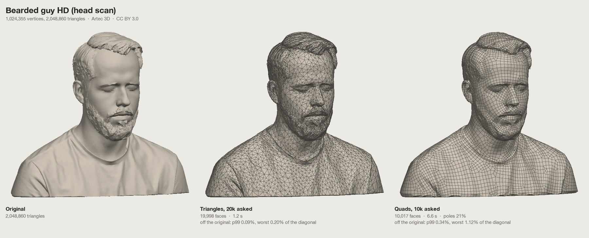
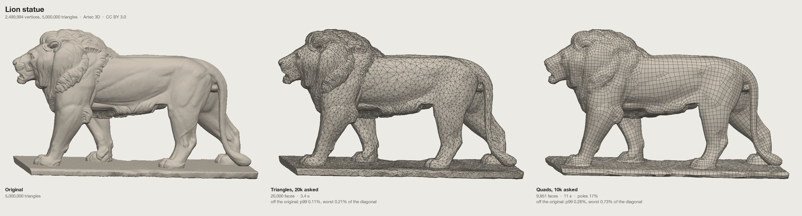
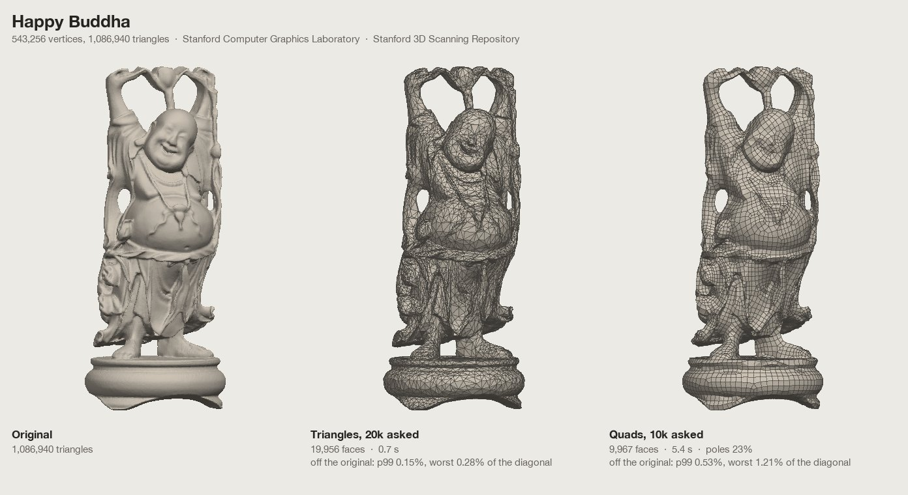

# Poly Budget: how it works

The technical notes behind [Poly Budget](https://ozdeger.github.io/poly-budget/): every feature in detail, how the remesher and the bakes work, what was measured, and how to build and test it. The [README](../README.md) is the product overview.

> [!NOTE]
> **Written by AI, not maintained by hand.** Everything in this repository, the code, the tests and these notes, is written and revised by an AI coding assistant (Claude, working in Claude Code) from its owner's requests. None of it is written or kept up to date by hand. Treat it as generated code: check what it produces before you rely on it, and read the code before you reuse it.

Poly Budget is for models that are far too dense for real-time use: scans, sculpts and AI-generated meshes that arrive with a million or more triangles, split vertices and thousands of UV islands. Set a budget, paint where the detail matters (surface no one can see gets less on its own), and the model is rebuilt as quads whose edges follow its shape, ready for editing, subdivision and rigging, with its textures baked onto the new surface. Switch the budget to **Triangles** to reduce the model's own triangles instead, which can keep its original UVs. The **Rig** workspace then gives the result a skeleton and skin weights, found from its shape and editable by hand, and the export carries them.

Everything runs in your browser. Models and textures are never uploaded.

## Examples

Scans of a million triangles and more, each shown as the original, reduced to 20,000 triangles, and remeshed into 10,000 quads. The numbers under each result are its faces, the time it took (in Node on an Apple M5 Pro), and how far the original's surface lies from it: at the 99th percentile and at worst, as a share of the model's diagonal. The models are in the [test collection](#develop).







The pictures show these models reduced and remeshed by Poly Budget: Bearded guy HD and the lion statue by Artec 3D (CC BY 3.0), and the Happy Buddha from the Stanford 3D Scanning Repository (Stanford Computer Graphics Laboratory).

## What it does

### Open a model

- FBX, GLB/glTF, OBJ with its MTL, STL and PLY, with PNG, JPG, WebP, TGA, BMP or GIF textures. Choose the files or drop them on the view, or start with the built-in sample pawn.
- Textures are matched to materials by the names the model asks for. Files it doesn't name are placed by their own name: normal, roughness, metal, AO and emissive maps are recognised, anything else becomes the base colour.
- The Texture section shows every material's maps as thumbnails. Click one to replace it; a missing file shows as a dashed tile until you provide it.
- Files often store a copy of each vertex per triangle corner, which decimators can't collapse, so vertices are welded first. Normals further apart than the hard edge angle stay split. Keep the merge distance low: a large one joins separate surfaces that come close.
- A file without vertex normals (many OBJ and STL exports) gets smooth normals worked out from its surface, and a normal map that an MTL lists under `map_Bump` is used as a normal map.

### Set the budget

- Type a triangle count, a short count like `20k`, or a share like `5%`. The slider runs from 0.1% to 100% on a log scale, and there are 50, 25, 10, 5 and 1% presets.
- The result sits right under the budget: triangles and vertices, how long the reduction took, the deviation from the original (average and largest distance, sampled at 4,000 points, as a share of the model's size), the texture state, and a bar of how the triangles split between painted regions.
- When a result misses the budget, it says why (Keep areas too large, the error limit, UV seams) and offers the fix in one click when there is one.
- Reduction options fine-tune the pass: an error limit that stops early, optimised vertex positions, even (the default) or very even triangles, how strongly shading is protected, locked open borders, and removal of tiny floating parts (pieces under 1% of the model's size). Normals are kept from the file, made smooth from the original's dense surface, or creased at an angle.

### Triangles or quads

The toggle at the top of the budget picks what comes out; Quads is the default.

- **Quads** rebuilds the surface as a new mesh of quads, at the budget's triangle count divided by two. The edges run along the shape, around limbs and across faces, so the result can be edited, subdivided and rigged. Unity still counts it as triangles (two per quad), so the budget means the same in both modes.
- **Triangles** reduces the model's own triangles, as described above. It keeps the most shape for the fewest triangles.
- In Quads mode the budget is typed and shown in quads (`12500`, `12.5k`); a percentage is still of the original triangles. Remeshing can't hit an exact count: it lands within a few percent, which counts as on budget.
- **Budget zones** under the slider show where the budget holds the model: red is too few quads to keep its shape, green is the range to aim for, and gray adds quads that change little you can see. The line below names both counts, for example "Holds the shape from about 6.0k quads; past 26k, more quads change little you can see."
  - They come from the curvature the quad sizes are made from. A quad side of length h along a direction in which the surface bends by κ misses it by about κh²/8. Every size Follow the shape asks for scales with one over the square root of the quad count, so the average miss scales with one over the count, and one pass over the model gives it at every budget. It takes 0.06 to 0.2 seconds, once per model and settings.
  - The remesher missed by about 1.2 times that prediction on the test models. Red ends where 1.2 times the predicted average miss falls to 0.13% of the model's size (the diagonal of its bounds), and gray starts at 0.03%. Two AI-generated characters, a car, three scans, a statue and a bike were remeshed at 500 to 32,000 quads. Their faces, glasses, hands and paws melted or came apart while the measured average deviation was over 0.13%, and looked like the original once it was under 0.03%.
  - Parts thinner than half a quad came apart in 73 to 96% of the cases. Where they cover more than 1% of the surface, red extends to the count where they stop coming apart, counting the quads Keep thin parts adds. A road bike's spokes need more quads than the bike has triangles, so its strip is all red.
  - Painted More and Less areas move both limits by the quads they add or save.
  - On six of the models both limits came within 1.35 times the counts where the measured average deviation crossed 0.13% and 0.03%. On the statue, gray came within 1.15 times, and red at twice the count it needed. The bike's deviation never got under 0.13%, as its strip says.
- Every face is a quad. The result card adds the quad count and the poles: vertices where other than four quads meet, which is where edge loops start and end.
- Painting sets the quad size: More detail gives 2, 4 or 8 times as many quads per area, Less detail ½, ¼ or ⅛, and Keep the smallest quads (8 times). Separate small pieces keep at least 24 quads, and flat lettering enough for its strokes to be two and a half quads across, from up to a fifth of the budget; on a model of hundreds of parts the smallest get just enough to be there. Specks smaller than a fiftieth of a quad are left out, and so are tiny floating parts when Remove tiny floating parts is on.
  - The paint is smoothed over a few of the original's vertices first. A brush leaves ragged edges and missed flecks far finer than a quad, and the grid broke up around them: a pedestal painted Less, flecked with unpainted and More vertices along its rings, tore open at 11 of 21 budgets, and now at none.
- Quads come out evenly sized, while a triangle reduction crowds its triangles onto the detail. At game budgets, paint More detail on faces and hands in Quads mode, or eyes and lips smooth away.
- **Keep sharp edges** (on by default) turns edges sharper than 45° into edge loops, so the rims and corners of hard-surface parts stay crisp instead of being bevelled. Short sharp runs, which on scans and AI meshes are surface noise, are ignored; "short" is measured in the local quad size, so where quads get small, shorter edges count.
  - Edges on both sides run along a kept sharp edge, and a grid line passes through it. On a flat face beside a crease, the edges used to run any way at all and meet the crease at an angle.
  - The two sides of a sharp edge share its edge loop, so with Follow the shape they share the step along it. The small steps around a cylinder carry onto its flat cap, where they widen gradually toward the middle, instead of meeting the cap's big quads at the rim and notching it.
  - On a cylinder with Follow the shape at 100%, 99% of the rims now lie on an edge loop, up from 86%; on a gear, 73% of its creases, up from 48%. Capped shapes pay a few poles for it, since a flat cap has to turn its grid all the way around its rim.
  - A rim rounded by a bevel much narrower than a quad counts as sharp too, though no single edge of it turns by 45°: the surface there turns by more than that across a third of a quad to either side. Its edge loop goes along the bevel's middle, where its faces switch from facing one side's way to the other's. A thin tube such as a finger, which keeps turning further out, doesn't count. A generated character's bracelet, with rims rounded over 3 to 5 mm under quads of 11 mm, used to come out as a barrel; now its rims stay crisp and its average deviation halves. On a band with rounded rims, 100% of the rims lie on an edge loop, up from 33%. Over 14 test models at 10,000 and 30,000 quads, three of them also mirrored, the average deviation from the original fell by 6.8%, the 99th percentile by 10.7% and the worst point by 10.8%, for about one more pole in a hundred vertices.
- **Keep thin parts** (on by default, with Follow the shape) keeps a part thinner than a quad whole: its cross-section gets at least one grid step across, where the budget allows. Otherwise its two sides land on one or two grid corners and it comes apart.
  - Each patch's thickness is how far a ray into the surface runs to the far side of the solid. Rays across a gap between parts don't count, since the grid can't join parts it has no edges between.
  - Connected thin regions get their smaller quads whole, cheapest first, from up to a tenth of the budget: lips, eyelids, ears and fingertips before the spokes of a wheel, which at game budgets are too many to save. Quads get at most twice as fine for it.
  - On a body scan at 5,000 quads, lips and ears keep their shape: the thin areas stay within 12 mm of the original at the 99th percentile instead of 16, and the worst point moves from 31 to 20 mm. Most scans gain a little accuracy. It costs up to one pole in a hundred vertices on most models, four on a hard-surface car scan; turn it off where the poles matter more.
- **Follow the shape** (75% by default) sizes and stretches each quad by the surface under it. A quad side of length h along a direction in which the surface bends by κ misses it by about κh²/8. For the same small error in every direction, a quad is short across the direction the surface bends most and long along the direction it bends least. A chain, strap or strand of hair gets long quads along it and several edges around it; a skirt fold gets long quads down the fold; a flat back gets big square ones. Square quads that keep the same error need more of them wherever the surface bends mostly one way.
  - The edge flow follows the shape too: where quads stretch, the edges turn to run along the direction of least bending.
  - The curvature is measured once per model, over patches about 0.3% of its size. Its signed averages cancel the noise of scans and generated meshes, and edges kept sharp are left out.
  - Quads stay between 0.15 and 2.5 times the average size, and at most twice as long as wide, so a rigged limb keeps its loops close enough across a joint to bend (at four times, a forearm's loops lay twice as far apart across the elbow). Sizes change gradually from place to place, so the grid can follow them.
  - Higher values follow the shape more closely, and changes of size cost poles. On a generated character at 21k quads, 0% misses the original by 0.078% of the model's size on average, with one vertex in nine a pole. 75% misses by 0.052%, with one pole in five or six vertices. 100% misses by 0.049%, with one in five. At 75% a necklace comes out as a round tube with long quads along it, instead of a flattened ribbon.
- **Fewer poles.** A quad side may get longer or shorter freely along its own direction, but across it only as fast as the edges bend. Sizes that change faster than that make the grid start extra rows of quads, and every row that starts or ends inside the surface leaves a pair of poles. So before the grid is laid, the sizes are adjusted where the ones the shape asks for can't be tiled, as little as possible and never much larger. Painted sizes are kept as painted. On two generated characters at 21k and 20k quads, this cut the poles from 23.7% to 19.3% and from 23.9% to 20.0% of the vertices, for 2 to 4% more average deviation. A torus, which needs no poles at all, gets half as many.
- Triangles mode does this by itself. The simplifier always takes the collapse that moves the surface least, so flat areas merge into large triangles first, small forms keep theirs, and triangles come out stretched the same way. For crisp small hard-surface details at a low count, Triangles mode is still the better choice.
- Mirror symmetry works the same way: the kept half is remeshed with the mirror plane held as an edge loop, then mirrored, so every vertex has its partner. Once mirrored, a vertex on the plane has its two edges along it plus twice its edges into the kept half, so it is regular only with exactly one edge inward, and the remesher lays the seam out for that. On a generated character, vertices on the seam with only two edges (a quad folded flat against the plane) fell from 12% to 4% of the seam, and those with six or more from 14% to 7%, while the poles overall went slightly down.
  - The seam holds where the kept half's grid is coarse beside the plane, as paint can make it. Which open borders lie on the plane is judged by each vertex's own quad size rather than the average one, a hole the grid leaves beside the plane is closed with faces instead of taking the seam along with it, a quad with two corners on the plane is never split into triangles between them, and a vertex boxed in by the seam goes onto the plane with it. On a character mirrored with its pedestal painted Less, 21 budgets out of 21 now come out closed and manifold, against 9 before (the paint smoothing counted in).
- A quad mesh has new topology, so its UVs are always new: the texture is baked onto them from the original, as for New UVs. The unwrap never cuts a quad in two.
- Normals are taken from the original surface where each new vertex sits (Original or Smooth), or creased at an angle.
- FBX and OBJ store the faces as quads. GLB can only hold triangles, so it gets two per quad.

Quads mode takes longer than a reduction, with the progress in the result card. For the example models at 10,000 quads it took 5 to 11 seconds, and 3 to 27 seconds for the other test models at 10,000 and 30,000 quads; two torture cases took longer, a restaurant interior of many small parts up to 37 seconds and a ball of hair strands up to 81 (in Node on an Apple M5 Pro).

### Paint where detail matters

Pick a tool from the palette on the left of the view; its options float above the model.

| Tool | Key | What the painted area gets |
| --- | --- | --- |
| More detail | M | the detail a 2, 4 or 8 times larger budget would keep there |
| Less detail | L | ½, ¼ or ⅛ of the triangles it would get otherwise |
| Keep original | K | its vertices stay exactly as they are (in Quads mode: the smallest quads) |
| Normal detail | N | the detail it would get without paint, kept out of the hidden-area levels (shown while Hidden areas is on) |
| Erase | E | no paint |
| Orbit | O | back to navigating |

Paint with the brush or fill one connected piece at a time (F). `[` and `]` change the brush size, ⌘Z / Ctrl+Z undoes and ⇧⌘Z / Ctrl+Y redoes. Paint shows on both views and is kept with the tab.

### Hidden areas

On by default. Surface that is hard to see gets fewer triangles on its own, without painting: crevices, the covered side of hair and clothing, parts pushed into each other.

- **How hidden:** once per model, a background pass measures how much of a sphere of views around the model reaches each vertex, weighting head-on views more (the measure of Zhang and Turk, *Visibility-Guided Simplification*, 2002). It takes a few seconds for a model of a million triangles and is kept with the tab, so it doesn't run again on the next visit.
- **How much less:** Gentle, Medium or Strong turn the least visible surface into Less detail at ¼ or ⅛, with ½ around it; Strong reaches further out. The areas show in the view in their own colour, fainter than paint, and the result bar counts their triangles.
- **Delete faces nothing can see** (off by default) removes surface that no direction reaches, such as the parts of pieces buried inside others, or sealed-off pockets.
- Your paint always wins. The Normal detail brush keeps an area at its normal detail even where it is hidden.
- Small, sharply curved parts keep their detail even where they are hidden: the hidden side of a thin ring or chain is what holds its visible side's round shape. Surface no direction can see is still deleted when that's on.
- It judges visibility from outside the model. Turn it off for rooms and other models seen from inside, and for parts that move into view when animated (the inside of a mouth that opens).

How much it helps depends on how much is hidden. On models made of parts pushed into each other, the buried surface can take a fifth of a plain reduction's triangles, and here it gets almost none. On single-surface characters, where hidden surface is mostly thin crevices, the gain is smaller: on two AI-generated characters the error on the visible surface went down by 5 to 15% on one and by 0 to 5% on the other, depending on the budget and the mode.

### Mirror symmetry

- Finds the plane the model is most symmetric about, on X, Y or Z, or takes the one you set.
- Reduces one half and mirrors it, so every vertex has an exact partner. The seam along the plane stays free to simplify.
- Says how symmetric the original was, and how many vertices of the result are paired.

### Keep the texture

Reducing a model drags its triangles across the texture. With few UV islands the original UVs still fit; with thousands of them, low budgets tear the texture apart.

- **Auto** measures how much of the texture would land in the wrong place with the original UVs. Up to 3% it keeps them; past that the reduced model gets new UVs.
- **Original UVs** always keeps them; **New UVs** always makes new ones. With the original UVs you can let collapses cross seams (lower counts, some smearing) and set how strongly the texture is protected.
- New UVs: the reduced mesh is cut into charts by surface direction, each chart is flattened (least-squares conformal maps) and the charts are packed into one sheet per material. Painted areas get texture space in proportion to their detail.
- **New UV layout**: **Compact** (the default) packs many small charts tightly, which gives the baked texture the most texels. **Paintable** lays the UVs out for painting by hand, in 3D or flat in an image editor: few large charts, one per part where it can, with their seams where they show least (on hidden surface, in folds, along sharp edges and where the original's colour changes), little stretch, every chart turned so the model's up points up the sheet, and the sheet laid out like the model standing, feet at the bottom and head at the top. Tubes such as arms and legs are cut open along their least seen side. Parts painted in clearly different colours get charts of their own. On five test models at 10,000 quads (two AI-generated characters, a car, a head scan and a cliff) it made 8 to 41 charts instead of 70 to 654, with a quarter to half the seam length, and filled 37 to 53% of the sheet against 52 to 64%. It takes a second or two longer than Compact.
- A chart is split again wherever the flattening would squash any face below 0.15 of its share of texels. A sliver like that reads its whole texture from a line of texels or the gutter beside it, and shows as a flat, off-colour patch. A quad folded more than 90° between its two triangles, as a remesh can leave in a tight groove, gets a chart of its own and is unfolded at its true size.
- The textures are then baked on the GPU from the original onto the new UVs, every map the material has (base colour, roughness, metalness and the rest), at 512, 1024 or 2048 px. Gutters around the charts are filled so mipmaps don't bleed.
- Where the reduced model shows a surface the original hides, the bake takes what the original shows from outside. A remesh can cut a few millimetres into a thick shell or open up a narrow pleat, and the surface underneath, which nobody was meant to see, often has a dark or unfinished texture. Each texel compares how visible its spot is on the reduced model with how visible the matched spot is on the original. When the original's is far lower, the bake looks again from further out along the same line, and the visible surface covering the spot takes over. On an AI-generated character whose remesh cut into its skirt, this removed a dark patch of about 5 cm² on each side of the front; elsewhere in the front, back and side views, the only pixels that moved away from the original were a few along the edge of a thin chain. Across 14 other remeshes of it, over five times as much surface moved closer to the original as moved away.
- The geometry shows at once; the new UVs and the bake follow in the background, and the textured model replaces the clay one when they are ready.

### Normal map from the original

On by default. The reduced model gets a normal map that carries the original's surface detail: folds, strands and small shapes the triangle budget can't hold, and the facets a low count leaves behind. Where the original has a normal map of its own, the two are combined.

- **No normal map needed.** For materials that come without one, **Detail from the base colour** (50% by default) adds the texture's fine painted detail as well: strokes, seams and weave, the way generators' own detail maps look. It is worked out per UV island of the original, so island borders don't emboss. Only detail a few pixels wide counts and hard colour boundaries are softened, so broad colour areas stay flat instead of turning into blobs or grooves. It does emboss painted lines such as eyelids too; lower it or set it to 0 if that shows.
- **Clean projection.** Rays look for the original along the result's normals averaged at each position, so they don't split at hard edges. They reach twice as far as the result strays from the original around each spot, and take the outermost surface facing out, which stays the same surface along an overhang. The reach is measured locally, on the faces around each vertex: one reach for the whole model is set by the parts that stray most, such as hair tips, and lets a spot elsewhere reach past its own surface to a separate part close in front, like a glasses frame printing onto the cheek under it. Only when that fails do they take the nearest surface on either side, and only after that the nearest point. Gutters repeat a chart's edge for a few texels and then stay neutral, so charts don't bleed into each other at low mip levels.
- **Inspect it** under Texture: a material that has no normal map of its own, or whose file is missing, gets a Normal tile with the baked map, marked Baked (it pulses while the bake runs). Clicking it opens the map in the Texture & UVs panel, where the baked normal map is listed with the original's maps and the original's side shows the map made from its base colour.

- **Shades the same in the engine.** The map is baked against MikkTSpace tangents, the ones Unity, Unreal, Blender and Godot work out on import, and as the exact inverse of how they rebuild the normal per pixel. The view uses the same tangents, so what you see is what the engine shows. Mirrored halves share the map and still shade correctly.
- **Works with either UV mode.** With new UVs every material gets one. When the original UVs are kept, the other textures stay as they are and only the normal map is baked, in place of the model's own.
- **Export:** FBX and OBJ link it as the normal map. The export panel picks its direction, OpenGL (Unity, Blender, Godot, the default) or DirectX (Unreal, green flipped). GLB always uses glTF's, which is OpenGL. A GLB holds no tangents, and glTF viewers then take green as pointing to the top of the image, which is −v in this tool's UVs, so the map goes in with its green turned.
- **Checked:** on a bumpy test surface reduced far enough that the triangles lose the bumps, normals rebuilt from the baked map, the way an engine does it, stay within about 1° of the true surface on average (2° at worst), against 8 to 12° from the reduced mesh alone. The same holds on the mirrored half, in Quads mode, with the original UVs kept, and when an existing normal map is combined in. Exported as GLB and read back with three.js's GLTFLoader, the sample (new and kept UVs), a PBR test model and a 1.5-million-triangle scanned cliff get every texel of their baked maps back. Rendered with the MikkTSpace tangents a glTF viewer works out and filtered the same way, their normals are within 0.01° of the view's on average; with three.js's own screen-space tangents, within 0.1 to 1.3°, against 1.8 to 16.6° with the green the wrong way round.
- Switch it off for materials that shouldn't carry a normal map; an original normal map is still carried over onto new UVs.

### Ambient occlusion

Off by default. **In base colour** or **Separate map** bakes the original's ambient occlusion with the texture: how much of the sky over each spot the model leaves open. Creases, folds, the gaps between strands and the undersides of overhangs come out darker, measured on the original's full detail, so the reduced model keeps that depth even where its own faces no longer have the shape.

- **What is measured.** At the spot of the original each texel matches (the same match the texture bake uses), the cosine-weighted share of directions over the surface that nothing in the model blocks. Every material shades every other. Occluders count fully up to a quarter of the model's size away and fade out by half of it, so distant parts of a large scene don't darken each other.
- **In base colour.** The base colour darkens where the spot is occluded, and a little where the surface faces down, as if lit by a sky (directions from above count more); open tops lighten slightly. Shadows keep their colour: chroma falls more slowly than lightness (in OKLab), so a red dress darkens to deep red rather than brown and grey stays grey. The depth shows with any lighting, or none. A material without a base colour texture gets one holding the shading alone, which the engine multiplies with its colour.
- **Separate map.** Each material gets an occlusion map, 1 where open and down to 1 − strength where nothing is open. GLB carries it as the material's occlusion texture; FBX and OBJ have no standard slot for it, so the zip holds `<model>_<material>_occlusion.png` to assign in the engine. When the original has an occlusion map of its own, the two are multiplied.
- **Strength.** How dark the most occluded spots get; at 100% the deepest creases go black. The occlusion is kept until the result, its UVs or the bake size change, so moving the slider or switching between the base colour and the map re-applies it in a fraction of a second.
- **Compare.** The Ambient occlusion button in the display palette (A) shows or hides it at once, in every shading, without a new bake: with it in the base colour, the bake also keeps the base colour as it was and white with the occlusion in it, which clay and facets show. What the view shows doesn't change the export.
- **New UVs only.** Quads always get them. A result that keeps the original UVs (Triangles mode) gets no occlusion, and the section says so.
- **Smooth without noise.** One fixed set of directions leaves straight streaks where an occluder's edge crosses them; random directions per texel leave grain. Each texel instead casts 64 directions from one of 16 turned and shifted copies of an even spread (a Fibonacci lattice), laid out so every 4 × 4 block of texels holds all 16, and the block is then averaged over the texels of the same surface: as smooth as 1,024 directions. On a floor beside a low wall, the steps where one set's directions cross the wall's edge shrink 7-fold.
- **Checked.** Against known answers: the bottom of a hemispherical bowl sees exactly half the sky (0.4999 measured), a floor beside an endless wall too (0.501). On a two-material test model, the GPU's values match the JavaScript reference in `core.js` (`ambientOcclusion`) within 0.0007 over 120 texels, which is half-float precision. Time on an Apple M5 Pro in Chrome: 1.4 s for the 188,000-triangle sample at 1024 px, 6 s for a 2-million-triangle character with dense curls at 2048 px.

### Display

The palette at the right of the view picks how the models show: **Textured**, **Clay** (the shape in one colour) or **Facets** (every face flat), with the **Wireframe** (W) over any of them. **Normal maps** (B) show or hide the original's own and the result's baked ones in textured and clay, so the bare shape of a remesh can be told from what its normal map adds; facets always show the bare faces. Baked **Ambient occlusion** (A) shows or hides on the result. Both switch at once, without a new bake, and neither changes the export.

### See the texture and its UVs

**Texture & UVs** (U) opens a panel beside the view: the original texture with its UV layout on one side, the reduced model's texture and layout on the other.

- Seams are drawn in cyan. Triangle edges fade in as you zoom, so even a dense layout reads as islands first.
- Scroll or pinch to zoom, drag to pan, double-click to fit. The footer reads out the UV and the texture pixel under the pointer.
- Choose the material and the map, seams only or every edge, one pane or both. Drag the panel's edge to resize it.

### Work in tabs

Each tab holds its own model, paint, mirror plane, budget, view and bakes. A model you open goes into a new tab, unless the current one is empty or shows the sample. Your tabs, with the files they were opened from, reopen as you left them on your next visit. They are kept in this browser's storage only; clearing the site's data removes them.

### Rig for animation

**Rig** at the top of the sidebar (R) turns the page to rigging the result: the reduced model alone, its skeleton drawn over it (faint where the model hides it), and the Skeleton, Bones, Weights and Pose sections. The rig goes with the tab and comes back with it.

- **Find the skeleton** reads a humanoid skeleton from the shape of a standing figure, in a T or an A pose or relaxed, with its limbs free of the body, saved Y up or Z up. It takes about a second.
  - The joints are Mixamo's: Hips, Spine, Spine1, Spine2, Neck and Head, and per side the Shoulder, Arm, ForeArm and Hand, the UpLeg, Leg, Foot and ToeBase, with end joints on the head and toes. **Fingers** get three joints each (thumb included) where the hands have them apart (Auto), always (laid out by a hand's proportions where they can't be read), or never.
  - **Joint names**: Mixamo's, which Unity's Humanoid, Godot's humanoid profile and Blender map on their own, or Unreal's mannequin names (`pelvis`, `spine_01`, `upperarm_l`, …).
  - Each joint's +Y points along its bone and +X is its hinge, the axis elbows, knees, the spine and fingers bend about; left and right are mirrored, so a turn about X bends both alike. The rest pose is the pose the model stands in.
  - A joint placed by a figure's proportions rather than read from the shape (an elbow on a straight arm, hips hidden by a skirt) shows in amber; the status line counts them.
  - A figure joined to a base gets a Root joint on the floor that carries the base, so the figure moves on it while the base stays put. Legs hidden in a skirt get their hips from the shoulders' height. Hair down the back doesn't pull the spine into it.
  - Where the head, hands and feet can't be told apart, the skeleton is laid out by a figure's proportions in the model's bounds, every joint amber.
- **Build your own** starts from a Root on the floor, for creatures, machines and props.
- **Move joints** (V): drag a joint and it settles halfway through the limb under the pointer, so it stays inside the body from any view; Alt keeps its depth instead, Shift brings everything below it along. With **Mirror**, its mirror image follows and joints on the mirror plane stay on it. A drag that starts off a joint orbits. Click a bone to select it.
- **Add joints** (J): click the model to add a joint there, in the middle of the limb, chained from the selected one; off the mirror plane they come in pairs. Esc starts a new chain.
- **Bones**: the joints as a tree. The selected joint can be renamed, given another parent or made a helper that doesn't move the mesh (end joints are); Delete removes it, and its children and weights go to its parent. Every edit can be undone (⌘Z).
- **Weights** are worked out by bone heat when the skeleton is found, and again whenever it changes, until you paint them. The Weights section shows the selected joint's weights as heat (blue none, red all), every joint in its own colour, or the problems: vertices with more joints than an engine takes (magenta; the export keeps the largest four) or none (red).
- **Painting weights**: Add (D), Subtract (S), Set to a value (G) and Smooth (H) paint the selected joint's weight, falling off smoothly to the brush's edge, with size (`[` `]`) and strength. **Connected** (on) keeps a stroke to the surface it starts on, so painting one thigh leaves the other alone; **Front faces** leaves the side turned away; with **Mirror** the joint's mirror image gets the same strokes on the other side. Dabs are a quarter of the brush apart along a stroke, and the weights under the pointer read out beside the brush.
  - A position's weights always sum to 1: what one joint gains the others give up in proportion, and what it loses goes back to them, or to its parent when nothing else holds any. **Locked** joints (the padlock in the bone tree) keep their weights through painting and smoothing.
  - **Smooth all**, **Clean** (weights under 5% dropped, at most four joints a vertex) and **Mirror L→R / R→L** work on the whole model. The mirror gives every position on one side the weights of the position nearest its mirror image, joints swapped, so a result that wasn't remeshed mirrored gets them too.
  - The weights live on the result's distinct positions, so the copies of a vertex along UV seams and hard edges always move together.
- **Pose** (P): click a joint and turn it with the gizmo in its own axes (red bends, green twists along the bone, blue turns about Z). **Test motions** loop until stopped (Space): Walk, Arms (up over the head and down, elbows and fingers bending), Squat (the feet stay where they stand, the hips going down and back as far as the bent legs take them), Twist, and Each, which bends every joint in turn and is the one a non-humanoid skeleton gets. The view is posed by linear blend skinning, as the engines do it; weights can be painted on the posed model; the pose never reaches the export.
- **A rigged file** brings its own skeleton: every bone, names and rest orientations kept, so animations made for it still fit, and its weights carried onto the result by position. Mixamo, Unreal and Left/Right, `_l`/`_r`, `.L`/`.R` names are recognised, so it gets the humanoid test motions and mirror editing. **Find the skeleton** replaces it with one read from the shape; **Use the file's skeleton** and **Use the file's weights** bring it back.
- **A new budget** keeps the rig: weights move to a result whose positions are the same (as when its UVs arrive), are worked out again for a new remesh, carried from the file again, or, where painted by hand, carried over from the last result by position and flagged for a look.

### Export

**Export** at the top right lists every file the zip will hold before you download it.

- FBX, GLB or OBJ with MTL, in the source file's units, metres or centimetres.
- The textures the model uses: the original files, or the baked maps when it has new UVs. FBX and OBJ materials link the base colour and normal map, and the other maps sit beside them in the zip. GLB carries its materials and textures inside, with roughness and metalness merged into glTF's one texture (roughness in green, metalness in blue).
- With new UVs, the UV layout as an image per material (`…_uvlayout.png`, at the bake size): black lines on a clear sheet, chart borders heavier than the quads' edges, to paint over.
- A rigged result carries its skeleton and weights, at most four joints per vertex. FBX gets a LimbNode per joint, a skin with a cluster per joint that moves vertices of that part, and a bind pose; GLB a skinned mesh through three.js's exporter. OBJ can't hold them, and the panel says so.

## Keyboard

| Key | Does |
| --- | --- |
| 1 / 2 / 3 | Side by side / original / reduced |
| Q | Triangles or quads |
| W | Wireframe |
| A | Show or hide the baked ambient occlusion |
| B | Show or hide the normal maps |
| U | Texture & UVs panel |
| O, M, L, K, N, E | Orbit, More detail, Less detail, Keep original, Normal detail, Erase |
| F | Brush or fill a part |
| `[` / `]` | Smaller / larger brush |
| ⌘Z / Ctrl+Z | Undo paint |
| ⇧⌘Z / Ctrl+Y | Redo paint |
| R | Shape or Rig workspace |
| O, V, J, P | Rig: orbit, move joints, add joints, pose |
| D, S, G, H | Rig: add, subtract, set or smooth weights |
| Space | Rig: play or stop the test motion |
| Delete, Esc | Rig: delete the selected joint; deselect, end a chain or stop the motion |

In the Rig workspace ⌘Z / Ctrl+Z undoes the rig's edits, poses and weight strokes.

## Command line

`cli/poly-budget.mjs` runs the app's work without the page, for scripts, build pipelines and coding agents. It opens and welds the model, finds hidden areas, applies paint rules and the mirror plane, reduces or remeshes, makes new UVs, writes the files Export would, and reports what came out. It runs the page's own modules (`src/core.js`, `quad.js`, `paint.js`, `visibility.js`, `collect.js`) with the app's defaults, so a result is the one the app makes with the same settings and paint.

```bash
npm install
node cli/poly-budget.mjs model.fbx --quads 10k -o out
```

`npm install -g .` in the repository adds a `poly-budget` command. It needs Node 20 or later. Dense models can need more memory than Node gives by default, so the command starts itself again with up to 16 GB (three quarters of the machine's memory, if that is less), unless `--max-old-space-size` is set.

```bash
poly-budget scan.obj --quads auto --json                        # a budget from the zones, the report as JSON
poly-budget statue.stl --quads 20k --mirror auto -f glb
poly-budget character.fbx body_color.png body_normal.png --tris 20k --uvs original --zip
poly-budget character.fbx --quads 12k --paint '[{"more": 4, "part": "Head"}]'
poly-budget model.glb --info                                    # counts, parts, materials, bounds, mirror plane
```

Textures come along as when they are dropped with the model: the ones it names are found among the files given or next to it, and other images given are placed by their names, as in [Open a model](#open-a-model). On the princess scan in [Examples](#examples) (2 million triangles), `--quads auto --mirror auto` with a paint rule took 20 s. That was 4.4 s for the zones, 5.5 s for the remesh, 3.1 s for hidden areas and 2.1 s for the mirror plane, in Node on an Apple M5 Pro. The 7.2-million-triangle Asian dragon took 33 s to 20,000 quads.

### Options

`poly-budget --help` lists them all. Each is a setting of the app, with the app's default:

| Options | In the app | Default |
| --- | --- | --- |
| `--quads <n>`, `--tris <n>` | Triangles or quads, and the budget: `12500`, `12.5k`, or `5%` of the original triangles | Quads, 10% |
| `--quads auto` | The middle of the green budget zone | |
| `--paint <rules>` | Painting, as rules (below) | none |
| `--hidden <off, gentle, medium, strong>`, `--delete-unseen` | Hidden areas, and Delete faces nothing can see | medium, off |
| `--mirror <auto, x, y, z, x=0.25>`, `--mirror-side <+, ->` | Symmetry: Detect (on every axis, or along one), or a plane; the half to keep | off, + |
| `--follow-shape <0-100>`, `--no-sharp-edges`, `--no-thin-parts`, `--remove-tiny-parts` | Remeshing | 75, on, on, off |
| `--stop-at-error <0.5%>`, `--triangle-shape <any, even, very-even>`, `--protect-shading`, `--lock-borders`, `--no-optimize` | Reduction options | no limit, even, 0.5, off, on |
| `--uvs <auto, original, new>`, `--uv-layout <compact, paintable>`, `--texture-size`, `--cross-seams`, `--protect-texture` | Texture | auto, compact, 1024, off, 1 |
| `--normals <original, smooth, creased>`, `--crease-angle` | Normals | original, 60° |
| `--hard-edge-angle`, `--merge-distance` | Welding | 30°, 0.0001% |
| `--rig <humanoid, original, none>`, `--fingers <auto, full, none>`, `--bone-names <mixamo, unreal>` | Rig: Find the skeleton with bone heat weights, or the file's own skeleton and weights | none, auto, mixamo |
| `-f`, `--format <fbx, obj, glb>`, `--units <auto, m, cm>`, `--zip` | Export | fbx, auto |
| `-o`, `--out`, `--name`, `--json`, `--info`, `--no-measure`, `-q` | The command line's own: where the files go and what it prints | |

`--quads auto` takes the middle of the green zone as the app's slider draws it: the geometric mean of where red ends and gray starts. The zones don't depend on the budget, so a remesh at 1,000 quads measures them first. With `--uvs new`, a model without UVs gets them too, which the app doesn't do.

### Paint rules

`--paint` takes a JSON list of rules, or a file holding one, and can be given more than once. Each rule gives the vertices it selects one kind of detail, as a brush in the app does, and later rules paint over earlier ones:

```json
[
  { "more": 4, "part": "Head" },
  { "keep": true, "material": ["Eyes", "Teeth"] },
  { "less": 8, "box": [0, 0, 0, 1, 0.05, 1], "relative": true },
  { "normal": true, "sphere": [0, 1.62, 0.08, 0.1] },
  { "erase": true, "part": "/^Hair/i" }
]
```

- `more` and `less` take 2, 4 or 8, the brush's ×2, ×4 and ×8; `keep`, `normal` (Normal detail) and `erase` take `true`.
- A rule selects by `part` (a mesh's name in the file), `material`, `box` ([x0, y0, z0, x1, y1, z1]) or `sphere` ([x, y, z, radius]). A vertex must match every selector a rule gives. Names match in any case, or as `/pattern/flags`; `--info` lists them.
- Boxes and spheres are in the model's units, or, with `"relative": true`, in shares of its bounds (0 to 1 along each axis; a radius as a share of the diagonal). Under mirror symmetry they also paint their mirror image, as the brush does. Parts and materials paint only themselves, so name both sides of a mirrored pair.
- A rule that selects nothing is reported.

### What comes out

The files are the ones the app's Export puts in its zip, written to `--out` (or as that zip, with `--zip`). They are the model, the original texture files while the original UVs are kept (FBX and OBJ link the base colour and normal map), and a UV layout sheet per material when the UVs are new.

The command prints a summary, or with `--json` a report. This is the one for the princess scan above, shortened:

```json
{
  "input": { "format": "obj", "triangles": 1984088, "vertices": 1000183, "uvs": true, "uvIslands": 33,
    "materials": [{ "name": "tete-egypte", "textures": { "map": "tete-egypte.png" } }], "missingTextures": [],
    "bounds": { "min": [-0.375382, -0.477437, -5.849113], "max": [0.412683, 0.259501, -4.617326], "diagonal": 1.637505 } },
  "mirror": { "axis": "x", "offset": 0.021334, "keep": "+", "found": true, "fit": { "mean": 2.0837, "max": 15.546, "unit": "% of largest dimension" } },
  "result": {
    "mode": "quads", "budget": { "asked": "auto", "quads": 26899, "triangles": 53798, "status": "on budget" },
    "quads": 27748, "triangles": 55496, "vertices": 32414, "poles": { "count": 4472, "percent": 16.1 },
    "zones": { "red": 12922, "gray": 55996, "by": "shape", "auto": 26899,
      "note": "Holds the shape from about 13k quads; past 56k, more quads change little you can see." },
    "regions": { "keep": 0, "more": 33636, "less": 0, "hidden": 0, "rest": 21860 },
    "uvs": "new", "uvCharts": 158, "symmetry": { "paired": 32414, "total": 32414 },
    "deviation": { "mean": 0.0294, "p99": 0.1879, "max": 0.691, "unit": "% of diagonal" }, "openEdges": 0, "nonManifoldEdges": 0
  },
  "textures": { "carried": [], "baked": false, "notCarried": ["tete-egypte.png"] },
  "files": [{ "name": "tete-egypte_27748quads.zip", "bytes": 2358198, "path": "out/tete-egypte_27748quads.zip" }],
  "warnings": ["The textures aren't carried onto the new UVs: baking them takes the app, which bakes on the GPU. …"],
  "seconds": { "open": 2.63, "weld": 1.2, "hidden": 3.12, "mirror": 2.09, "zones": 4.35, "reduce": 5.51, "unwrap": 0.61, "total": 20.05 }
}
```

- `deviation` is how far the original's surface lies from the result: 60,000 points spread over the original, as percentages of its diagonal. It is the bench's measure, the one in [Examples](#examples) and the one the budget zones were checked against. The app's Deviation measures from the result to the original, at 4,000 points, against the largest dimension, so the two differ.
- `zones` are in quads, and `null` where no budget reaches a limit. `regions` counts the result's triangles by what set their density.
- `rig`, with `--rig`: the skeleton (`humanoid` or `file`), its joints and how many deform, the names, whether it has fingers and a Root for a base, the joints placed by proportion (`estimated`, to check), how the weights were made, and every bone's name, parent and position.
- `warnings` has what the app's result card and Texture section would point out, and what the command line left out.
- It exits with 0 when done, 1 when the model couldn't be processed, and 2 when the options or files are wrong. With `--json`, an error is also printed as `{"error": "…"}`.

From Node, `cli/pipeline.mjs` gives the same without the command. `run(file, options, progress)` returns `{ report, files }`, with the files as `{ name, bytes }` in memory, and `inspect(file)` is `--info`. The options take the app's setting names (`DEFAULTS` there):

```js
import { run } from './cli/pipeline.mjs';
const { report, files } = await run('model.fbx', { topology: 'quads', budget: '10k', mirror: 'auto', paint: [{ more: 4, part: 'Head' }] });
```

### What it leaves to the app

- **The bake.** Textures aren't carried onto new UVs, and no normal map is made from the original: both run on the GPU in the page. Quads always get new UVs, so they come without textures, with the UV layout sheet to paint over. Triangles mode keeps the original UVs and their texture files while they fit, or always with `--uvs original`.
- **Textures in GLB.** A GLB comes with its materials but without textures, since they aren't decoded here. FBX and OBJ link the copied files.
- **Colour in the paintable layout.** Without the texture's pixels, the paintable layout places its seams by visibility, folds and sharp edges, but not where the colour changes.
- **Fixing the rig by hand.** `--rig humanoid` gives the skeleton and weights as Find the skeleton makes them; moving joints and painting weights takes the app.

## How it works

1. **Collect.** Every mesh in the file is flattened into one world-space triangle list with part and material ids (`src/collect.js`).
2. **Weld.** Vertex copies at the same spot (within the merge distance) with the same UV and close enough normals are merged.
3. **Find hidden areas.** A third worker casts rays from every vertex over a cosine-weighted hemisphere, a couple per vertex on dense models and up to 64 on light ones, and averages them over neighbours. Closed shapes look outward only (inside-out ones are flipped first); open surfaces such as cards count whichever side is more visible. Vertices that come out as never seen are checked again with 32 rays before they count as hidden for good. The result turns into Less levels under the paint, and into deletions when asked. A model with UVs gets the pass too, with Hidden areas off, because the bake reads it.
4. **Reduce.** [meshoptimizer](https://github.com/zeux/meshoptimizer) does the collapsing, in a web worker. Less areas are simplified first to their own share with their borders held; More areas lock the vertices that a 2, 4 or 8 times larger budget keeps; Keep areas are locked outright. One last pass brings the whole mesh to the budget, weighing normals, UVs and vertex colours so shading and texture hold.
5. **Check the UVs.** The original UV layout is rasterised once; for each result, Auto counts the texels its triangles now cover in the wrong island.
6. **Unwrap.** New UVs are made in a second worker, so reductions never wait for them. The same worker then measures the result's own visibility, with a few rays per vertex, for the bake. The paintable layout (`src/paint.js`) measures that visibility first and reads the original's base colour under every vertex, and gives every edge a seam cost: high on seen, smooth surface, low on hidden surface, in folds, along sharp edges and where the colour changes. Small first charts grow across the costliest edges first while the curvature they enclose stays small, so their borders settle on cheap edges. Charts then join in rounds, the pairs with the costliest seam between them first, each chart in one attempt per round; a join stands when the joined chart flattens without folding or overlapping itself and without stretching seen surface much. Tubes and holes are opened along the cheapest path between their border loops, and each border between two charts moves to the cheapest line that still separates their cores (a minimum cut) when both charts then flatten as well. Flattening is least squares conformal maps, or Tutte's embedding when those fold, then as-rigid-as-possible iterations (Liu et al. 2008) that never step far enough to flip a triangle; a joined chart starts from its two parts' layouts, and only the part near the join moves until the final polish. A flattened chart overlaps itself exactly when its border crosses itself, which is what is checked. Each chart is turned so the model's up points up the sheet and its quads' edges run along it, and the packer places the biggest charts first, each where its outline fits closest to its height on the model.
7. **Bake.** For every texel of the new layout a shader finds the original surface below it (along the result's averaged normals, within a cage twice as deep as the result strays from the original around that spot, measured at the centres and edge midpoints of the triangles at each vertex: the outermost surface facing out, else the nearest on either side, else the nearest point that faces the same way) and keeps the matched triangle and the point on it. If that point is seen far less on the original than the texel's spot is on the result, the outermost surface facing out, from two and then four cages out along the same line, replaces it when it lies in front of the spot and is seen about as well. From there it reads the original UV and samples each map, and for the normal map takes the original's normal (bent by its own normal map, if any) into the result's tangent space. The tangents are MikkTSpace ones at each triangle corner, from meshoptimizer's tangent module in its compatible mode. With ambient occlusion on, a pass casts each texel's interleaved set of 64 rays from the matched point against a BVH of the whole original, as many rows at a time as fit in about 25 ms of GPU time, then merges the sets over 4 × 4 texels of the same surface (judged by their normals); the base colour or occlusion map pass reads the result. [three-mesh-bvh](https://github.com/gkjohnson/three-mesh-bvh) answers these queries on the GPU, and the work is spread over frames so the view stays responsive.
8. **Export.** FBX and OBJ are written directly; GLB goes through the three.js exporter (`src/glb.js`). The exporter draws the normal map onto a canvas to turn its green, and roughness and metalness to merge them, and a canvas can't draw a baked map's raw pixels (a DataTexture), so the export materials get canvas copies of them, the rows in the same order and `flipY` kept. That also writes a texture with `flipY` set, such as a TGA, the right way round, which the exporter misses for raw pixels.

### Quad remeshing

Quads mode replaces step 4 with a remesher (`src/quad.js`) that follows [Instant Meshes](https://github.com/wjakob/instant-meshes) (Jakob, Tarini, Panozzo and Sorkine-Hornung, *Instant Field-Aligned Meshes*, SIGGRAPH Asia 2015):

1. The welded model is merged once more by position alone, so UV seams, hard edges and material borders no longer cut the surface.
2. With Follow the shape, the edge lengths wanted along each direction are worked out first. Curvature tensors from the normal cycle (Cohen-Steiner and Morvan, *Restricted Delaunay Triangulations and Normal Cycle*, 2003) are summed over patches about 0.3% of the model's size, and give the two principal curvatures and their directions. Each patch gets edges of c/√κ along each principal direction, clamped, with c set for the budget. Then no edge length may grow faster than 0.3 times the distance from a neighbour's, per direction (Alauzet, *Size Gradation Control of Anisotropic Meshes*, 2010). This keeps the long edges even all around a tube, as a grid of closed loops needs, and lets the grid follow the sizes. Across a kept sharp edge only the length along the edge is graded, since both sides share that edge loop; it shrinks at most threefold, and quads stay at most twice as long as wide. With Keep thin parts, each patch's thickness (a ray from five of its vertices straight inward to the far wall, the median of them) caps its edges so that a cross-section spans a grid step, for connected thin regions in order of cost, from up to a tenth of the budget; c is then set again for the rest.
3. The painted density is averaged with its neighbours' three times, in log, so the brush's ragged edges and flecks go (clusters keep sizes apart, and each fleck made clusters of its own). A dense surface is clustered into a working surface of about two and a half vertices per shortest quad edge. Edges still longer than 0.7 of a grid step along their own direction are split, up to 40 working vertices per quad asked (scans need about 12; across strands thinner than a quad, splitting would multiply the input).
4. A multi-resolution hierarchy of ever coarser vertex graphs is built. Two fields are smoothed on it from the coarsest level down. The direction field says which way edges run, up to quarter turns. The position field says where the corners of a grid of the target edge lengths sit, and that grid may be longer one way than the other. The fields read normals smoothed over about one quad, sparing edges sharper than 60°, so bumps smaller than a quad don't seed poles. Along kept sharp edges each vertex takes one side's normal. Kept sharp edges are long enough runs of edges sharper than the angle, and of edges where the surface turns by it across 0.3 quads to either side, walked straight across the surface: the middle of a bevel narrower than a quad, where its faces switch from facing one side's way to the other's, unless the turn keeps growing twice as far out (a thin tube). Those within half a quad of the mirror plane are dropped, since the plane is an edge loop already. Painted density and small pieces shrink the grid locally. Where the wanted edges are longer one way, the direction field is pulled toward that way. Open borders, the mirror plane and kept sharp edges are constraints: edges run along them, and a grid line passes through them.
5. The grid steps are fitted to what the direction field allows. A grid with steps s<sub>u</sub> along the edge direction e<sub>1</sub> and s<sub>v</sub> across it closes up only where ∂<sub>e2</sub> log s<sub>u</sub> = −ω(e<sub>1</sub>) and ∂<sub>e1</sub> log s<sub>v</sub> = ω(e<sub>2</sub>), with ω the rate at which the direction field turns (Cartan's structure equations for the co-frame e<sub>1</sub>/s<sub>u</sub>, e<sub>2</sub>/s<sub>v</sub>). Where the wanted steps break this, the position field answers with a pole pair, a dislocation in the grid, which QuadriFlow (Huang et al., *QuadriFlow: A Scalable and Robust Method for Quadrangulation*, 2018) counts as a position singularity. On a torus with even steps, nearly nine in ten poles sit within two edges of one. The log steps are fitted to the condition in least squares on the working surface's triangles, held to the wanted steps with a weight that makes them drift over about eight quads. Growth costs 25 times more than shrinking, and steps stay between the smallest the working surface resolves and 1.1 times the wanted ones. ω is averaged over neighbouring triangles, since per triangle it is noisy, and painted density is left out of the fit. The first grid is scaled for the density change, so the first extraction lands on the budget.
6. Input vertices on the same grid corner are merged and those one grid step apart are joined; faces are read off this graph by walking around each vertex. Holes where the grid tore across a fold tighter than a grid step are closed. Loops along open borders and the mirror plane stay open: a border edge split into pieces for the working surface keeps its mark on every piece, or a border along a few long input edges (a flat cap cut by the plane, a sheet of two triangles) would look like a tear and be closed. Beside the mirror plane a hole joins the plane's own open loop, which then runs along the plane, turns into the surface and comes back; such a detour, border vertices off the input's borders between two on them, is closed with faces on the polygon it makes with the straight way back along the plane. Which open loops lie on the plane is judged by each vertex's own grid step, which paint can make three times the average.
7. Instant Meshes leaves some triangles and pentagons among the quads. Odd faces side by side, which is how a misplaced grid step shows, or with one quad between them, are merged and cut into quads again, with the cut that leaves the fewest poles. Each remaining odd face is paired with its nearest odd neighbour (or an open border) through the faces between them, the edges those paths cross are split, and every face, now with an even number of sides, is cut into quads. The density barely changes, unlike Instant Meshes' own all-quad mode, which splits every face in four. Under symmetry, a vertex on the plane with d edges counts as it will once mirrored, 2(d − 3)² against (d − 4)² inside, since inner vertices appear twice. Pairing an odd face with the plane through its own edge there leaves a vertex with no edge inward, so paths to the plane count two faces longer; a triangle there whose two corners on the plane have one edge inward each, and whose third corner has five or more, is removed by merging those corners instead, which keeps one.
8. Edge rotations and diagonal collapses that lower the number of poles are applied (the moves of Tarini et al., *Practical Quad Mesh Simplification*, 2010), and leftover defects are repaired, leaving open borders and the plane open. On the plane they use the same count: a rotation can hand an edge from a vertex with two inward to its neighbour with none, and a vertex with none can take the place of its quad's opposite corner when that corner has three edges. The repairs close holes the grid tore open, and a hole with an odd number of edges takes a triangle: extraction can leave such a tear, and the all-quad pass can turn a hole odd, since it pairs odd faces with a hole's edge as it would with an open border. So the faces the repairs leave odd are paired once more, with each other or a real border, and cut into quads. That pass runs in about half the remeshes of the bench's models, which had 1 to 270 lone triangles each before.
9. Vertices near a kept sharp edge are moved onto it (corners onto their corner), and all vertices are relaxed toward their neighbours along the surface and projected back onto the original; those on a sharp edge only slide along it. A vertex whose neighbours all lie on the mirror plane goes onto it too, and mirroring drops the faces that lie in the plane. Each try is counted after the repairs of step 8, which on models of many small or thin parts drop or add a fifth of the faces. If the count missed the budget by more than 4%, the grid size is corrected, up to three times: first as faces ∝ size⁻², then by how the count responded to the last change, since pieces that vanish or appear make it respond more steeply. The closest try is kept. The search stops early when a try gets no closer, and the grid never gets finer than half the first try's, which the working surface is built for; when it stops short that way, the result card says that parts thinner than a face can't take the rest. How far the count missed is remembered (unless the search stopped short), so the next budget usually lands on the first try, and asking for a budget again gives the same quads. The working surface, hierarchy and direction field are kept between budgets that round to the same step, so trying nearby budgets is quicker.
10. Each quad becomes two triangles for the rest of the tool, never along a diagonal with both ends on the mirror plane (both triangles and their mirrored copies would share it), marked as a pair so the unwrap, the UV panel, the wireframe and the FBX and OBJ writers all treat it as one face.

The Instant Meshes code is under a BSD licence, whose notice is kept at the top of `src/quad.js`.

### Rigging

The skeleton and weights are made on the result (`src/rig.js`, `src/skin.js`; the workspace is `src/rigui.js`), in a worker, over the result's distinct positions joined into one surface graph.

1. **The body plan.** The mirror plane is the app's when Symmetry is on, otherwise the axis plane the result is most nearly mirror-symmetric about (nearest-point distances of its mirrored samples, the offset found by golden-section search). Up is the longer of the two axes along it (Y when they are about as long, as three.js, glTF and most exporters have it); a model whose hands lie below its middle is upside down. The body is the largest piece. Geodesic distance (Dijkstra along edges) from the body vertex nearest its centroid peaks at the ends of the limbs; a peak's persistence is how far its region reaches before it meets a higher peak's. The hands are the long-lived peaks farthest out from the plane on each side, the feet the lowest ones, and the head the top of the body on the plane. Front is where the toes point from the legs, or +Z (Blender's −Y with Z up) when they don't say.
2. **A base.** Where the bottom of the shape is one piece across the plane and higher up it narrows by a third to legs standing apart, one to each side, the base is cut away a little above, so a raised rim goes with it. The feet then end where they meet it, a Root joint on the floor carries it, and its weights go wholly to the Root.
3. **Limbs.** Each limb is traced from its tip by rings of equal geodesic distance: the level set's segments joined into loops through the edges they share, the loop around the limb chosen by the shortest path back to the body. The rings' centroids run down the middle of the limb and their length is its girth. Where a ring suddenly grows (1.8 times the median of those before) the limb has met the trunk; a leg's search starts above the lowest fifth of the figure, as rings across a heel grow too. The tip is taken again as the point farthest from a ring partway down, as the first peak can sit on the side of a toe cap.
4. **Joints.** The ankle is the sharpest turn of a leg's centreline low down, from along the foot to up the leg; the toe joints lie along the foot. The wrist is the narrowest ring past the widest one of the hand (the palm, or where the thumb joins), the nearest to the hand of rings about as narrow. Elbows and knees are where the centreline bends by over 20° in the middle half of the limb, else at a person's proportions (thigh and shin even, upper arm and forearm 0.56 to 0.44). The hip and shoulder joints lie on the thigh's and upper arm's axes where they meet the trunk; with the arms lowered the armpit closes before the axis reaches the shoulder joint, which carries on inward until the top of the shoulder is about an arm's radius above it. A leg whose girth doubles within a tenth of the height has gone into a skirt or shorts, and its hip goes where the torso, from hips to shoulders 0.29 of the figure's height in a person and in a big-headed stylised character alike, puts it. The neck is the narrowest ring below the head, the neck joint where it has flared by a third into the shoulders, or just above the shoulders where no neck shows. The hips sit just above the hip joints, centred front to back; the spine runs from them to the shoulder joints' line in even steps.
5. **Fingers.** The hand is what lies past a plane across the wrist; its fingertips are the long-lived peaks of the distance from the wrist ring. The thumb is the one that branches off nearest the wrist, the others are ordered across the hand from it. Each finger is traced like a limb; its knuckle lies past where it meets the palm, its joints at 0.45 and 0.75 of its length (the thumb's at 0.4 and 0.73, its base deep in the palm).
6. **Symmetry and orientation.** On a symmetric model each pair of joints is averaged with its mirror image, or takes the side that was read rather than estimated, and the middle joints go onto the plane. Each joint's +Y points to its main child (Spine from the hips, Neck from Spine2, the middle finger from the hand); X is `cross(Y, front)`, or `cross(Y, ±up)` for a bone running front to back, which mirrors correctly by itself.
7. **Weights by bone heat** (Baran and Popović, *Automatic Rigging and Animation of 3D Characters*, SIGGRAPH 2007, the method behind Blender's automatic weights). Each joint's weight solves −Δw + Hw = Hp, with H = 1/d² for a vertex at distance d from the nearest bone it can see (the straight line to it crosses no triangle, tested on a BVH) and p 1 where that bone is the joint's. Edges are weighted by a third of their triangles' area over their length squared: the cotangent weight on even triangles, never negative on the long thin ones a reduction leaves, where clamped cotangents had made the weights spread three times too far (a hand held 65% of its own weight on average, 87% now). One sparse L D Lᵀ factorisation (after Davis's LDL), ordered by nested dissection (halves by position, the vertices along each cut last), serves every joint. Pieces that see no bone (eyes inside the head) and pieces under 1% of the surface move rigidly with the bone nearest their middle. A mirrored result's weights are averaged with their partners', left and right joints swapped.
8. **Export.** Each position keeps its four largest weights over 1%, summed to 1. FBX: a LimbNode Model and NodeAttribute per joint with its rest transform under its parent (Euler angles in FBX's XYZ order), a Skin deformer per part with a Cluster per joint (Indexes, Weights, Transform as the inverse of TransformLink, the joint's rest matrix), and a BindPose. GLB: a SkinnedMesh bound at rest to a Skeleton of three.js bones, which GLTFExporter writes as joints and inverse bind matrices. Positions and bones are scaled alike.
9. **A file's skeleton.** `collect.js` reads every bone of a skinned file, its rest matrix in the same space as the collected positions (the mesh's world matrix times its bind matrix's inverse times the bone's bind matrix), bones no skin uses included, and four joints and weights per collected vertex; meshes that aren't skinned follow the bone they hang from. The rig keeps each bone's rest place and orientation. Weights reach the result from the three nearest collected vertices, by inverse distance; a position left without any goes to the nearest bone.

**Checked** (`test/test_rig.js`, on generated figures: a smooth union of capsules meshed by marching tetrahedra into one closed surface, 1.77 m tall, with known joints):

- Placement: in a T and an A pose, with separate fingers and with mitten hands, every joint lands within 3% of the height of where the figure was built on it (1.0 to 2.3 cm on average), and on a base within 5%, with a Root. A figure saved Z up comes out Z up. It takes 0.6 to 1.1 seconds in Node on an Apple M5 Pro. By eye it also holds on an AI-generated character in a skirt with long hair, standing on a base; on the striding Artemision bronze; and on a body scan saved Z up in an A pose, whose fingers it finds at 40,000 quads.
- Weights: between 0 and 1 and summing to 1; along the middle of the forearm, upper arm, shin, thigh and head their own bone holds 85 to 98%; the elbow is shared about evenly, with one bone over 85% ten centimetres to either side; copies of a vertex along creases are weighted alike; a mirrored result's are exact mirror images; eyes inside the head move with it; a base goes to the Root. 48,000 positions with 65 joints take 0.8 seconds.
- Export: read back by three.js (FBX and GLB) and Assimp (FBX), the skin leaves the mesh where it is at rest, and posed by its bones it matches the app's own skinning to within 0.1 mm. A rigged file opened again gives the same joints, within 10 µm and 0.001°, and the same weights.
- Editing: weights painted up and down still sum to 1 with a locked joint untouched; smoothing and Clean leave at most four joints a vertex; Mirror L→R gives the right forearm the left one's total weight within 1%. The squat keeps the feet within 3 cm of where they stood.

## Browser support

A current Chrome, Edge, Firefox or Safari with WebGL 2. Baking textures onto new UVs also needs float render targets (`EXT_color_buffer_float`), which current desktop browsers have; without them, keep the original UVs. The page loads its libraries from jsDelivr, so it needs a connection to start.

## Limits

- Skinned meshes are reduced in their bind pose; their skeleton and weights come along in the Rig workspace (or with `--rig original`), but their animations don't.
- Finding the skeleton reads standing two-legged figures with their arms free of the body. Arms fused to the sides, legs joined together, crouching or lying figures, quadrupeds and other creatures need their joints placed by hand (or built with Build your own). Bone heat weights are smooth but don't know cloth from skin: a skirt follows the thighs, which hand painting fixes.
- One UV set per model.
- Memory is the browser's: a model of 1.5 million triangles with 4K textures works on a desktop, phones may run out.
- Quads mode doesn't reach the quality of dedicated retopology tools on every model. Expect some poles: about one vertex in nine with even quads, and one in five following the shape on organic models. Parts much thinner than a quad edge come out rough where Keep thin parts can't afford them: at game budgets strands of hair, spokes and cables are too many to save and break up. A few folded quads from the grid can still leave one or two non-manifold edges on some models.
- The budget zones are estimated from the shape and its thin parts, measured against the size of the whole model. They don't see the texture, and they don't know which parts will be seen close up; paint More detail there.

## Project layout

`node build.js` (or `npm run build`) turns `src/` into `index.html`, the single file GitHub Pages serves, and `dist/poly-budget.html`, the same page without a document wrapper for hosts that add their own.

| File | What it holds |
| --- | --- |
| `src/index.html` | Markup and styles |
| `src/app.js` | The UI: loading, tabs, painting, the texture and UV panel, the GPU bake, saving the session, export |
| `src/core.js` | The mesh work, with no DOM code so it also runs in Node: welding, the reduction passes, the quad pipeline around the remesher, the UV fit check, unwrapping, UV layout edges, the FBX and OBJ writers |
| `src/quad.js` | The quad remesher: working surface, field hierarchy, extraction, the all-quad pass, pole moves and relaxation, and the budget zones |
| `src/paint.js` | The paintable UV layout: seam costs, charts, joins checked by flattening them, upright charts and the packing |
| `src/visibility.js` | How visible each vertex is from all sides, for hidden areas and the bake |
| `src/rig.js` | Skeletons: the humanoid template and joint names, rest orientations, finding the skeleton on the result, a file's own skeleton, and the test motions |
| `src/skin.js` | Skin weights: bone heat, limiting, painting, smoothing, cleaning and mirroring them, carrying them between surfaces, and posing by linear blend skinning |
| `src/rigui.js` | The Rig workspace: the skeleton overlay, editing joints, the weight brushes, posing and the test motions, the rig's history and what the export and the saved tab take from it |
| `src/collect.js` | Flattens a three.js scene into one mesh |
| `src/glb.js` | The GLB writer, through three.js's exporter |
| `src/worker.js` | Reductions, unwraps and the visibility pass, off the main thread |
| `src/fbx_template.json` | The FBX header and definitions the writer starts from |
| `cli/poly-budget.mjs` | The command line: its options, progress, summary and the files it writes |
| `cli/pipeline.mjs` | The app's work from opening a model to its export, in Node, with the report; `run()` and `inspect()` for other scripts |
| `cli/load.mjs` | Opens models in Node as the app does, with the textures they ask for; the bench and the renderer use it too |
| `cli/measure.mjs` | How far the original lies from a result, open edges, and the app's mirror plane search on a small BVH; shared with the bench |
| `cli/png.mjs` | A PNG writer, and the UV layout sheet drawn without a canvas |
| `social-preview.jpg` | The picture link previews show: a scan of the Artemision bronze (Statens Museum for Kunst, CC0) beside its remesh into 10,000 quads, with More detail painted on the head |
| `apple-touch-icon.png` | The icon for home screens and for link previews that can't use the page's inline one |
| `LICENSE`, `THIRD_PARTY_NOTICES.md` | MIT for the code; the Instant Meshes notice, the runtime libraries and the pictures' own licences |

Libraries, loaded at runtime from jsDelivr: [three.js](https://threejs.org) with its loaders, exporter and fflate, meshoptimizer and three-mesh-bvh. The command line uses the same versions of three.js and meshoptimizer from npm, the package's two dependencies. The type is IBM Plex.

## Develop

- `npm install` installs the packages the tests and the command line use.
- `npm run serve` previews the built page at http://127.0.0.1:8731.
- `npm test` runs the checks on generated shapes: welding, painted reduction, the FBX and OBJ writers, symmetry, new UVs, paintable UVs, UV layout edges, normals, quad remeshing, the budget zones, the bake's reach, ambient occlusion, the GLB writer, rigging (on figures from `test/figure.js`) and the command line.
- To add a real model to a check, pass its path: `node test/test_unwrap.js path/to/model.fbx`. The same works for `test_core.js` and `test_symmetry.js`.
- `test/models/manifest.json` lists free models of 500k vertices and more for real-world testing, each with its source, licence, credit and what it tests: scans, characters and figures, textured photogrammetry with fragmented atlases, a PBR set with a normal map, hard-surface parts, scenes and stress cases. The files aren't in the repo:
  - `node test/models/fetch.mjs --tier=core` downloads the 14 core models (0.86 GB) into `testdata/models/`; `--tier=extended` and `--tier=stress` add 13 more, `--list` shows them all and `--check` asks the servers whether the files are still there. Models inside a large archive are read out of it in pieces, so only their own bytes are downloaded.
  - `node --max-old-space-size=16384 test/models/bench.mjs --tier=core` runs each fetched model through Triangles and Quads mode as the app does (`--mirror` adds mirrored quads) and prints the time, faces against the budget, how far the original's surface lies from the result, poles and open edges. `--json=file` keeps the rows for comparing two versions.
  - The pictures in [Examples](#examples) come from the same runs: `bench.mjs --tier=core --tris=20000 --quads=10000 --mirror --save=testdata/models/results --json=testdata/models/results/runs.json` keeps every result, `node test/models/render.mjs --tier=core` draws them next to the original from each model's `view` in the manifest, and `python3 test/models/sheets.py --examples=docs/examples` (needs Pillow) adds the labels and writes the JPEGs.
- `testdata/` and `local/` are ignored by git, for your own models and helper scripts.
